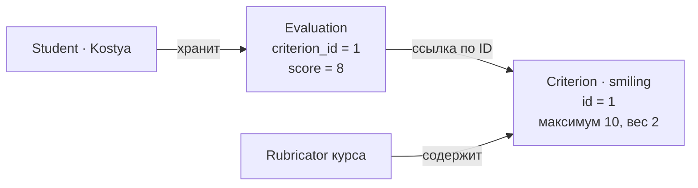

# ПОС · Преподавательская оценка студентов

Консольная ведомость одного курса. Преподаватель регистрирует студентов, задаёт критерии с максимумом и весом, выставляет оценки и выгружает итоговые проценты.

## Запуск

Из корня проекта, на Python 3.12:

```sh
python3.12 -m venv .venv
.venv/bin/python -m pip install -r requirements.txt
.venv/bin/python main.py --help
```

Дальнейшие примеры используют активированное окружение (`source .venv/bin/activate`). Команды запускаются отдельно. Посмотреть аргументы конкретной команды можно через `python main.py grade add --help`.

## Где хранятся данные

Задание требует показать расчёт и экспорт итога. Папка и имя выходного файла в задании не установлены. В этой реализации есть два места хранения:

- **Рабочие данные** — каталог `data/` в текущей директории. В нём три файла: `students.csv` (ID и имя), `criteria.csv` (ID, название, максимум и вес) и `evaluations.csv` (ID студента, ID критерия и балл). Каталог и файлы создаются при первой команде. Чтобы выбрать другой набор данных, используйте, например, `python main.py --data-dir demo-data student list`.
- **Выгрузка итогов** — отдельный файл, например `python main.py report export results.csv`. Укажите новое имя в существующем каталоге. В отчёт входят ID и имя студента, количество оценённых и общее количество критериев, итоговый процент. Пустая ведомость содержит только заголовок.

Все CSV используют UTF-8 с BOM и разделитель «;». Реализация рассчитана на macOS и Linux.

## Сквозной пример

Пример рассчитан на пустой каталог данных. Команды добавления выводят присвоенные ID. Для заполненной ведомости список ID покажут `student list` и `criterion list`.

```sh
python main.py student add Kostya
python main.py student add Mark
python main.py criterion add smiling 10 2
python main.py criterion add weight 20 3
python main.py grade add 1 1 8
python main.py grade add 1 2 15
python main.py grade add 2 1 6
python main.py grade list 1
python main.py report result 1
python main.py report export results.csv
```

Итог считается по критериям, за которые студенту выставлена оценка. У `Kostya` за `smiling` стоит 8 из 10, а за `weight` — 15 из 20. С весами 2 и 3 итог равен 77% по формуле `100 × (2 × 8/10 + 3 × 15/20) / 5`. У `Mark` оценён только `smiling`, поэтому его итог — 60% (6 из 10). Если поставить ему 0 за `weight`, в расчёт войдёт и вес второго критерия, а итог снизится до 24%. Когда у студента ещё нет оценок, консоль показывает «—», а поле итога в CSV остаётся пустым.

Исправление и отмена:

```sh
python main.py grade change 1 1 9
python main.py grade delete 1 2
```

## Границы слоёв

| Слой | Ответственность |
|---|---|
| [presentation](presentation/cli.py) | Разбор аргументов через argparse, подготовка запросов и форматирование ответов. Команды сгруппированы по студентам, критериям, оценкам и отчётам. |
| [Use case’ы](use_cases/) | Каждый сценарий объявляет запрос, ответ, интерфейсы зависимостей и обработчик в одном модуле. В сценариях изменения оценки обработчик загружает студента, вызывает доменный метод и сохраняет оценки. |
| [domain](domain/student.py) | Студент владеет своими оценками, рубрикатор объединяет критерии, критерий проверяет допустимый балл. Доменный сервис рассчитывает взвешенный итог. |
| [infrastructure](infrastructure) | CSV-репозитории сохраняют и восстанавливают доменные объекты. CSV-писатель принимает уже рассчитанные строки отчёта. |
| [container.py](container.py) и [main.py](main.py) | Контейнер Dependency Injector связывает конкретные репозитории и писатель с обработчиками. Точка входа разбирает команду, открывает каталог ведомости, получает приложение из контейнера и выводит ответ после успешного выполнения. |

На время команды приложение блокирует каталог ведомости через служебный файл `.lock`. Параллельные вызовы CLI не перезаписывают изменения друг друга. Каждая операция изменения обновляет один CSV-файл: сначала записывает временную копию, затем атомарно заменяет рабочую.

## Карта DDD

Язык модели совпадает с языком преподавателя. «Выставить», «исправить» и «отменить» — три разных действия. Например, повторный вызов `add_evaluation` для той же ячейки завершается ошибкой. Чтобы изменить выставленный балл, преподаватель явно выбирает исправление.

| Понятие | Роль | Что хранит и какое правило защищает |
|---|---|---|
| Студент — `Student` | Entity, корень агрегата | Целочисленный ID определяет студента даже при совпадении имён. Студент владеет текущими оценками. Словарь по ID критерия и методы изменения обеспечивают одну оценку на критерий. Снаружи словарь доступен для чтения. [Студент](domain/student.py) |
| Рубрикатор — `Rubricator` | Корень агрегата критериев | В пределах курса рубрикатор один. Метод `add` отклоняет повторяющийся ID, а `require` находит существующий критерий или сообщает об ошибке. [Рубрикатор](domain/rubricator.py) |
| Критерий — `Criterion` | Entity внутри рубрикатора | ID задаёт идентичность. Название, максимум и вес описывают критерий. Максимум и вес положительны. Метод `check` проверяет верхнюю границу балла. [Критерий](domain/criterion.py) |
| Оценка — `Evaluation` | Value Object внутри студента | Содержит ID критерия и балл. При создании находит критерий в рубрикаторе и проверяет диапазон. Исправление заменяет значение в той же ячейке. [Оценка](domain/evaluation.py) |
| Балл, вес и имена | Value Objects | `Score(8)` равен другому `Score(8)` по значению. Балл — целое число от нуля, вес — целое число от единицы. `StudentName` и `CriterionName` дают разным понятиям разные типы. [Балл](domain/score.py) · [Вес и название критерия](domain/criterion.py) |
| Итог — `FinalScore` | Результат доменного сервиса | `FinalScoreService` соединяет оценки конкретного студента с максимумами и весами общего рубрикатора. Возвращает процент и покрытие, например «оценён 1 критерий из 2». [Доменный сервис](domain/final_score_service.py) |

Как в ведомости представлена запись «Kostya получил 8 из 10 за smiling»:



Балл 8 принадлежит студенту. Максимум 10 и вес 2 заданы один раз для всего курса. Поэтому исправление балла у `Kostya` заменяет одну оценку в его ведомости. Тот же критерий по-прежнему доступен для оценки `Mark`.

Use case выставления оценки загружает студента и рубрикатор через интерфейсы репозиториев, создаёт проверенную оценку, вызывает `student.add_evaluation(...)` и сохраняет оценки. Ошибка проверки прерывает сценарий до вызова `save`. CLI получает DTO с обычными числами и строками. [Сценарий и интерфейсы](use_cases/evaluate_sudent.py) · [DTO](use_cases/dto.py)

## SOLID

- **S — единственная ответственность.** `FinalScoreService.calculate` вычисляет взвешенный процент. `CsvResultsWriter.write` получает готовые результаты и записывает их в CSV. Формула расчёта и формат файла меняются независимо. [Расчёт](domain/final_score_service.py) · [Запись CSV](infrastructure/csv_results.py)
- **O — открытость к расширению.** Чтобы добавить формат выгрузки, достаточно реализовать `IResultsWriter.write(destination, rows)` и выбрать реализацию в контейнере. Один и тот же `ExportResultsRequestHandler` готовит строки для любого такого писателя. [Порт и обработчик](use_cases/export_results.py) · [Контейнер](container.py)
- **L — подстановка Барбары Лисков.** `CsvStudentRepository.get(id)` выполняет контракт `IListStudentEvaluationsRepository`. Для известного ID он возвращает `Student` с текущими оценками, в том числе с пустым списком оценок. Для неизвестного ID сообщает об ошибке. Любой адаптер этого интерфейса должен соблюдать оба условия. [Интерфейс](use_cases/list_student_evaluations.py) · [Реализация](infrastructure/students.py)
- **I — разделение интерфейсов.** Репозиторий просмотра оценок предоставляет `get`. Репозиторий исправления предоставляет `get` и `save`. Интерфейсы объявлены рядом со своими обработчиками, поэтому требования каждого use case’а видны в его файле. Оба интерфейса реализует один `CsvStudentRepository`. [Просмотр](use_cases/list_student_evaluations.py) · [Исправление](use_cases/change_student_evaluation.py)
- **D — инверсия зависимостей.** Обработчик исправления принимает интерфейсы репозиториев через конструктор. Конкретные `CsvStudentRepository` и `CsvRubricatorRepository` подставляет DI-контейнер. [Интерфейсы и обработчик](use_cases/change_student_evaluation.py) · [Сборка](container.py)

**Упрощение.** Сценарии расчёта и экспорта напрямую зависят от `FinalScoreService`. У курса одна формула, сервис работает в памяти, поэтому отдельный интерфейс калькулятора здесь только повторил бы сигнатуру `calculate`. [Получение итога](use_cases/get_student_result.py)

## Паттерны GoF

**Singleton (порождающий) — один экземпляр репозитория на контейнер.** В `container.py` репозиторий студентов объявлен как `providers.Singleton(CsvStudentRepository, store, rubricator)`. Обработчикам регистрации, просмотра и исправления нужен этот репозиторий. Контейнер создаёт его при первом запросе и передаёт тот же объект остальным обработчикам. При следующем запуске CLI создаётся новый контейнер; данные между запусками сохраняет CSV. [Контейнер](container.py)

**Adapter (структурный) — из строк CSV в объект студента.** При вызове `get(1)` репозиторий берёт имя из `students.csv`, находит оценки по ID студента в `evaluations.csv` и собирает `Student`. Обработчик может вызвать `student.change_evaluation(...)`, а затем `save(student)`. Разбор строк и обратная запись оценок сосредоточены в `CsvStudentRepository`. [Адаптер](infrastructure/students.py)

**Iterator (поведенческий) — обход критериев рубрикатора.** Рубрикатор хранит словарь по ID. Обычный цикл по словарю вернул бы ключи, а для расчёта нужны сами критерии с максимумами и весами. Поэтому `Rubricator.__iter__` возвращает `iter(self._index.values())`, и сервис получает каждый критерий обычным циклом `for criterion in rubricator`. [Рубрикатор](domain/rubricator.py) · [Использование в расчёте](domain/final_score_service.py)

## Проверка и роль ИИ

```sh
.venv/bin/python -m unittest -v tests.test_grading
```

Доменные тесты проверяют непустые имена, границы балла, отсутствующий критерий, защиту от повторной оценки, пересчёт после исправления и отмены, пустой рубрикатор и отсутствие оценок. [Тесты](tests/test_grading.py)

**Моя роль.** Я определил границы слоёв, разработал доменные модели и сделал use case’ы `list_students`, `add_criterion` и `change_student_evaluation`. Для остальных use case’ов я задал тот же шаблон с запросом, ответом, интерфейсом репозитория и отдельным обработчиком. Я также уточнил правило расчёта итога: в него входят только критерии с выставленной оценкой.

**Роль Codex.** По моим моделям и шаблону Codex реализовал остальные обработчики, консольные команды и работу с CSV. Он написал модульные тесты, подготовил `requirements.txt` и помог оформить README.
